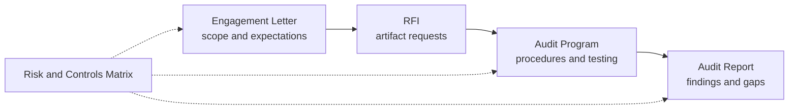

# PQC Controls, Risk & Audit Resource Kit

A resource kit for assessing **post-quantum cryptography (PQC) readiness** through the risk, control, and audit lens that financial institutions and other enterprises already use. It provides a **Risk and Controls Matrix** mapped to established frameworks, and a complete **Audit Program** (engagement letter, request for information, audit procedures, and report template) so that Internal Audit, External Audit, and Boards can form an objective, independent view of quantum preparedness.

Produced by the **PQC Controls, Risk, and Audit Working Group**, a workstream of the Quantum Readiness Working Group (QRWG) of the [Canadian Forum for Digital Infrastructure Resilience (CFDIR)](https://ised-isde.canada.ca/site/spectrum-management-telecommunications/en/learn-more/committees-and-stakeholders/committees-and-councils/canadian-forum-digital-infrastructure-resilience-cfdir).

---

## Background

The PQC Controls, Risk, and Audit Working Group aims to align PQC risk and control domains with the frameworks, standards, and control environments that financial institutions (FIs) and other enterprises are already leveraging. Rather than asking organizations to adopt a new vocabulary, this workstream translates quantum risk into the language of their existing governance, risk, and compliance programs.

Doing so lets FIs and other enterprises better understand their **risk and control gaps**. It also equips their **Internal Auditors and External Auditor partners** to provide an objective, independent review of a company's preparedness for quantum risks, and to share their opinion as part of their **Audit Universe** and **Board responsibilities**.

## Guiding Question

Organizations already assure many technology and cyber risks through established three-lines-of-defence models, control frameworks, and audit cycles. Quantum risk is different in character: cryptography underpins the confidentiality, integrity, and availability of nearly every digital system, and the transition to quantum-safe cryptography is a long, multi-year, enterprise-wide effort that touches vendors, infrastructure, data, and process. The guiding question of this workstream is:

> **How can an organization's preparedness for quantum risk be assessed objectively and independently, using the risk, control, and audit frameworks it already has?**

In this context, "preparedness" is intentionally broad. It includes governance and accountability, cryptographic inventory and visibility, exposure of long-lived sensitive data, third-party and supply-chain dependencies, cryptographic agility, migration planning and execution, and the organization's ability to evidence all of the above to an auditor, a regulator, or a Board.

## Why a Controls, Risk and Audit Approach

A structured risk-and-controls approach is well-suited to this challenge because it turns an abstract, technical, long-horizon threat into something that boards, executives, and assurance functions can act on today. Specifically, it:

- **Meets organizations where they are.** Mapping PQC risk domains to frameworks such as COBIT, SOX, NIST Cybersecurity, and ISO means organizations can extend existing control libraries rather than build a parallel program.
- **Makes gaps visible and comparable.** A common matrix gives first, second, and third lines of defence a shared reference for identifying, assessing, and managing quantum risk.
- **Enables independent assurance.** Standardized audit documentation lets Internal and External Auditors scope, request evidence for, test, and report on quantum readiness consistently.
- **Prevents scope drift.** A clear engagement letter and RFI make sure auditors and auditees understand what is expected of each other before fieldwork begins.
- **Supports Board oversight.** A structured report gives Audit Committees and Boards an evidence-based opinion on preparedness and the deficiencies that need to be addressed.

## Who this is for

| Audience | How they use this kit |
| --- | --- |
| **Internal Audit** | Scope and execute a quantum-readiness review; fold results into the Audit Universe and annual plan |
| **External Auditors / assurance partners** | Use a common set of procedures and evidence requests when providing independent opinions |
| **Risk, Compliance, CISO and IT leadership** | Identify control gaps, prepare for audit, and prioritize remediation |
| **Boards and Audit Committees** | Understand preparedness level and hold management accountable for quantum risk |

## What's in this repository

The kit is organized as a set of reusable, adaptable templates. Each piece can be used on its own or together as an end-to-end assurance toolkit.

| Folder | What it is | Status |
| --- | --- | --- |
| [`risk-controls-matrix/`](./risk-controls-matrix) | The **Risk and Controls Matrix** (spreadsheet): PQC risk domains, control objectives, and control activities linked to common frameworks | Planned |
| [`audit-program/`](./audit-program) | **Audit Program documentation**: engagement letter, RFI, audit program, and audit report templates | Planned |
| [`docs/`](./docs) | Methodology, risk domain definitions, framework mapping guide, glossary, and FAQ | Planned |
| [`examples/`](./examples) | Illustrative, fictional completed examples showing the templates in use | Planned |
| [`slides/`](./slides) | Summary material for working group and Board briefings | Planned |

> Folder structure and deliverables are working-group drafts and may evolve as the workstream progresses.

## The deliverables

### 1. Risk and Controls Matrix

A structured tool, generally a spreadsheet, for **identifying, assessing, and managing** quantum-related risks. It links PQC risk domains to the controls and frameworks organizations already use (for example COBIT, SOX, NIST Cybersecurity, ISO, and others), so that gaps can be identified using existing control language.

Indicative structure:

- **Risk domain and risk ID**: for example governance and accountability, cryptographic inventory, data exposure ("harvest now, decrypt later"), third-party dependencies, cryptographic agility, migration program management, key management and PKI, and incident response
- **Risk description and inherent rating**
- **Control objective and control activity**, with control type (preventive, detective, corrective) and owner
- **Evidence / artifact** an auditor would expect to see
- **Framework references** (COBIT, SOX/COSO, NIST, ISO, and others)
- **Residual rating and gap assessment**

### 2. Audit Program Documentation

A set of four linked documents covering the audit lifecycle:

| Document | Purpose |
| --- | --- |
| **Engagement Letter** (draft) | Outlines the scope of the audit review and ensures auditors and auditees clearly understand what is expected of each other. Guards against scope drift. |
| **RFI (Request for Information)** | Lists the artifacts the auditors will request and the auditees will provide. |
| **Audit Program** | A structured list of audit procedures that auditors use to conduct the review. |
| **Audit Report** | Provides an overview of the review and details any deficiencies or gaps that need to be addressed. |

## Quick start

1. **Start with the matrix.** Open the Risk and Controls Matrix in [`risk-controls-matrix/`](./risk-controls-matrix) and identify which risk domains and framework mappings apply to your organization.
2. **Scope the review.** Adapt the draft Engagement Letter in [`audit-program/`](./audit-program) to agree scope, objectives, and responsibilities between auditors and auditees.
3. **Request evidence.** Issue the RFI so that auditees know which artifacts to prepare and auditors know what they will receive.
4. **Execute the procedures.** Use the Audit Program to test design and operating effectiveness of the relevant controls.
5. **Report.** Summarize results, deficiencies, and recommendations using the Audit Report template, and take them to management, the Audit Committee, and the Board.

New to the topic? Begin with the methodology overview in [`docs/`](./docs).

## Standards and Regulatory Alignment

The Risk and Controls Matrix is designed so that PQC risk and control domains can be traced to the frameworks, standards, and control environments already in place at FIs and other enterprises. Candidate framework references include:

| Framework / standard | Relevance |
| --- | --- |
| **COBIT** | IT governance and management objectives |
| **SOX / COSO** | Internal control over financial reporting and enterprise internal control |
| **NIST Cybersecurity Framework** | Cyber risk outcomes and control categories |
| **ISO/IEC 27001 / 27002** | Information security management and control catalogue |
| **Others (to be confirmed by the working group)** | For example NIST SP 800-53, sector and prudential regulatory guidance, and Internal Audit professional standards |

> The framework list above is indicative. Final mappings will be published in [`docs/`](./docs) alongside the matrix once reviewed by the working group.

## Related work

This kit complements other Quantum Readiness Working Group efforts, including the **TTX Scenario Planning Workstream**, which stress-tests plausible futures in which quantum-enabled attackers could trigger systemic and cascading failures. Where the TTX work explores how bad things could get, this workstream focuses on whether organizations can demonstrate, and have independently verified, that their controls are ready.

## About CFDIR and the Quantum Readiness Working Group

This work is produced for the [Canadian Forum for Digital Infrastructure Resilience (CFDIR)](https://ised-isde.canada.ca/site/spectrum-management-telecommunications/en/learn-more/committees-and-stakeholders/committees-and-councils/canadian-forum-digital-infrastructure-resilience-cfdir), and specifically for its **Quantum Readiness (QR) Working Group**.

The QR working group is responsible for creating guidelines and best practices documents, which are updated annually. These documents are important because quantum technologies are poised to play a major role in Canada's future, from its national security to its economic standing. While Canada is among the global leaders in quantum research, it nevertheless faces challenges in the adoption of these technologies as they approach market readiness. According to [Canada's National Quantum Strategy](https://ised-isde.canada.ca/site/national-quantum-strategy/en/canadas-national-quantum-strategy) (2022), the total economic impact of quantum technologies in Canada by 2025, including indirect and induced effects, was estimated at $533 million, with 1,100 jobs and $188.3 million in returns.

The materials created by the QR working group are designed to help critical infrastructure sectors plan and prepare for the transition of digital systems to standardized quantum-safe cryptographic technologies and solutions, in order to protect the confidentiality and integrity of their data and systems. Collaborative work through bodies such as the CFDIR will be critical in the years ahead to identify what needs to be done, and when, in order to get ready for a post-quantum world.

## Status

This is a **working-group draft**. The templates and mappings are intended as practical starting points to be adapted to each organization's risk appetite, control environment, and audit methodology. They are not legal, regulatory, financial, or professional audit advice, and do not represent the official position of the Government of Canada, ISED, or any participating organization.

## License

This work is dedicated to the public domain under [CC0 1.0 Universal](https://creativecommons.org/publicdomain/zero/1.0/) (see [`LICENSE`](./LICENSE)). To the extent possible under law, the contributors have waived all copyright and related or neighboring rights to the materials in this repository. You are free to copy, modify, distribute, and use the work, including for commercial purposes, without asking permission.

Attribution is not required, but it is appreciated. If you reuse or adapt the kit, consider citing it as:

> PQC Controls, Risk, and Audit Working Group, CFDIR Quantum Readiness Working Group. *PQC Controls, Risk & Audit Resource Kit.*

Please do not present adapted versions as endorsed by CFDIR or the working group.

## Contributing

Contributions from risk, control, audit, security, and quantum-readiness practitioners are welcome. See [`CONTRIBUTING.md`](./CONTRIBUTING.md). Issues and pull requests are encouraged. This kit is meant to be adapted, not just read. By contributing, you agree that your contributions are released under the same [CC0 1.0 Universal](https://creativecommons.org/publicdomain/zero/1.0/) dedication as the rest of the repository.

## Contact and acknowledgements

- **Working group lead(s):** [Name(s) / organization(s)]
- **Contributors:** [To be added]
- **Contact:** [Email or issue tracker link]
